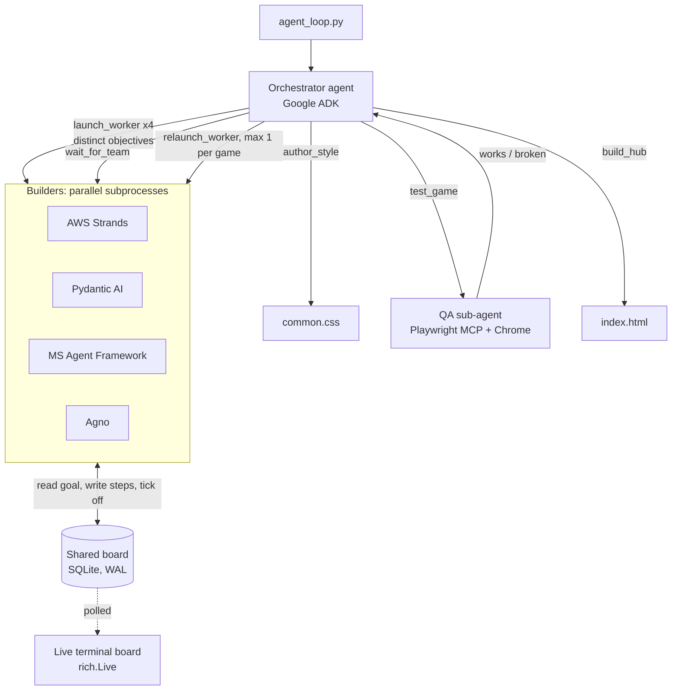

# Agent Loop: an LLM orchestrator that manages a team of agents built on different frameworks

An orchestrator agent (Google ADK) designs a curriculum, delegates one mini-game to each of four builder agents (AWS Strands, Pydantic AI, Microsoft Agent Framework, Agno), QA-tests every result in a real browser, sends broken games back for one fix round, and assembles a playable web arcade.

```bash
uv run agent_loop.py --topic "RAG"
```

## What this demonstrates

| Skill | Where |
|---|---|
| Multi-agent orchestration where the LLM owns decisions and code owns mechanics | `orchestrator.py` |
| Interoperability across 4 agent frameworks behind one contract (task id + shared board) | `catalog.py`, `board.py` |
| Agent-as-tool pattern: a QA sub-agent with a real browser via MCP (Playwright) | `qa_agent.py` |
| Closed feedback loop: build, verify, repair (bounded to one round) | `prompts.py` (`ORCHESTRATOR_PROMPT`) |
| Failure containment: timeouts, call budgets, process-tree kill, deterministic fallbacks | `orchestrator.py`, `css_agent.py` |
| Real-time observability of concurrent agents | `live_board.py` |

## How it works



1. **Style.** The orchestrator calls `author_style`; an art-director agent writes a shared `common.css`.
2. **Delegation.** For each framework the orchestrator chooses a distinct learning objective and calls `launch_worker`. Each builder is a separate OS process that reads its goal from the shared board, invents its own game, and writes `game.html`, `game.css`, `game.js`.
3. **Coordination.** The board is one SQLite table (`todos`: goal, steps, status, result) in WAL mode with a busy timeout, so concurrent writers need no server. Each worker writes its own step todos under its goal and ticks them off. A `rich.Live` view renders the board per worker colour.
4. **Verification.** `test_game` spawns a fresh, call-bounded QA agent per game. It opens the game over `file://` in Chrome through the Playwright MCP server, interacts, reads the console, and reports a verdict via a `report_game` tool.
5. **Repair.** For each broken game the orchestrator calls `relaunch_worker` once with a symptom description, waits, and re-tests.
6. **Assembly.** `build_hub` writes `index.html` linking the finished games. A deterministic check then prints `ok / INCOMPLETE` per game.

## Design decisions

- **Agent owns decisions, tools own mechanics.** The orchestrator is an LLM agent with six tools, not a Python loop calling workers. Objective selection, who to re-test, and when to stop are model judgements; process spawning, waiting, and file checks are code.
- **Framework-agnostic worker contract.** A worker is any executable invoked as `<runner> <worker_file> <task_id> <board_path>`. The only coupling is the board schema, so adding a framework is one entry in `catalog.py`.
- **Board as the only communication channel.** Workers never talk to the orchestrator directly; stdout/stderr go to `DEVNULL`. This keeps the live view clean and makes progress observable from one place.
- **Bounded everything.** Orchestrator: 80 LLM calls. QA agent: 25 calls per game. Worker timeout: 300 s. QA timeout: 150 s. Fix attempts: 1 per game. A QA agent that exhausts its budget while still interacting is treated as "works", which avoids spurious fix rounds.
- **Graceful degradation.** If the style or hub LLM call fails or returns empty output, a built-in template is written. If the orchestrator crashes, `_ensure_site` still produces a usable site from the games already on disk.
- **Process hygiene.** Workers start in their own session (POSIX) or are killed with `taskkill /T` (Windows), so a timeout stops the whole uv/npx/MCP tree. The MCP toolset is closed inside the event loop with bounded timeouts to avoid hangs and `__del__` teardown errors.
- **Cross-platform.** `shutil.which` resolves `uv`/`npx` on Windows; stdout is forced to UTF-8.
- **Cost control.** Models are swappable via `ORCHESTRATOR_MODEL` and `WORKER_MODEL` (`config.py`).

## Requirements

- Python 3.11+ and [`uv`](https://docs.astral.sh/uv/)
- Node.js (for `npx @playwright/mcp`) and Google Chrome
- API keys in `.env`:
- The worker files referenced in `catalog.py` (sibling folders `2_strands_pydantic/`, `3_maf_agno/`). Missing workers are skipped automatically.

## Usage

```bash
uv run agent_loop.py                         # default topic: AI
uv run agent_loop.py --topic "Kubernetes"    # any topic
uv run agent_loop.py --skip agno             # exclude a framework
uv run agent_loop.py --dry-run               # print the plan, run nothing
uv run agent_loop.py --no-open               # do not open the browser at the end
```

| Env var | Default | Purpose |
|---|---|---|
| `ORCHESTRATOR_MODEL` | `gemini-3.1-flash-lite` | Orchestrator, art director, QA agent |
| `WORKER_MODEL` | `gpt-5.4-mini` | Builder agents |
| `WORKER_TIMEOUT_S` | `300` | Per-worker wall-clock limit |
| `QA_TIMEOUT_S` | `150` | Per-game QA limit |
| `QA_HEADLESS` | unset | `1` runs the QA browser headless |

Output goes to `site/`: `index.html`, `common.css`, one folder per framework (`strands/`, `pydantic/`, ...), and `board.sqlite`.

## Project layout

```
agent_loop.py     CLI entry point, wiring, final deterministic check
orchestrator.py   ADK orchestrator agent, its six tools, subprocess lifecycle
qa_agent.py       Browser QA sub-agent (Playwright MCP)
css_agent.py      Art-director agent: common.css and index.html, with fallbacks
board.py          SQLite todo board shared by all agents
live_board.py     rich.Live terminal view of the board
catalog.py        Worker manifest, discovery, launch commands
prompts.py        All prompts and task templates
config.py         Model selection
quiet.py          Log and warning suppression for readable traces
```

## Known limitations

- Game quality varies by model and objective; QA verifies that a game loads and responds, not that its content is pedagogically correct.
- One fix round per game by design; a game still broken after it is left as is and reported in the final check.
- Workers depend on sibling project folders, so this repo does not run standalone.
- Browser QA requires a local Chrome and network access to fetch `@playwright/mcp`.